  

I like building things that think, move, or keep secrets: agents that plan and remember, graphs that keep LLM answers honest, simulated worlds you can drive a car through, and the occasional blockchain written just to understand how one works.

By day I'm an AI engineer at Accenture in Milan. The rest of this page is the fun part.

## Things I'm into

  

## Things I've built

  
  

  
  

## Say hi

Always up for a chat about agents, graphs, simulators, or a good puzzle: [LinkedIn](https://www.linkedin.com/in/gioele-allievi/)
